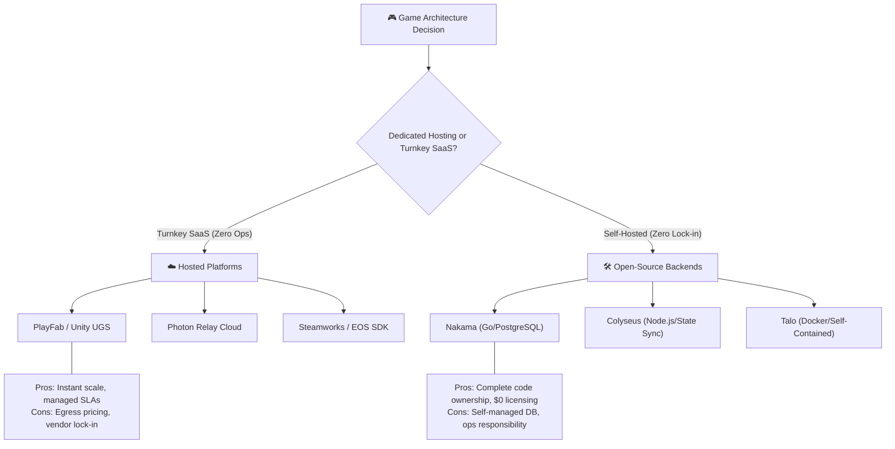

# 🎮 Awesome Gaming & Hardware Tools

  <strong>A curated directory of premier SaaS platforms, platform SDKs, and open-source infrastructure powering modern game development and gaming hardware ecosystems.</strong>

  
  
  
  
  
  

---

## 📌 Executive Summary & SEO Meta Overview

The **Awesome Gaming & Hardware Tools** repository aggregates the definitive technology stack required to build, deploy, operate, and optimize video games and interactive hardware. Covering enterprise **Game Backend as a Service (BaaS)**, console and PC **platform SDKs**, **realtime multiplayer networking engines**, **game telemetry pipelines**, and **self-hosted open-source server architectures**, this directory serves indie developers, AAA engineering leads, hardware enthusiasts, and game preservationists alike.

---

## 📑 Table of Contents

- [📊 Sector Overview & Market Dynamics](#-sector-overview--market-dynamics)
- [☁️ SaaS & Hosted Platforms](#️-saas--hosted-platforms)
- [🛠️ Open-Source GitHub Projects](#️-open-source-github-projects)
- [💡 Architectural Guide: SaaS vs. Self-Hosted](#-architectural-guide-saas-vs-self-hosted)
- [🤝 How to Contribute](#-how-to-contribute)
- [⚖️ Disclaimer & Compliance](#️-disclaimer--compliance)
- [🏷️ Keyword Index](#️-keyword-index)

---

## 📊 Sector Overview & Market Dynamics

The global **Gaming Tools & Backend Services** sector is currently valued at **$5.2 Billion USD** (within the broader $250B+ global video games and gaming software economy) and is projected to expand to **$12.8 Billion USD by 2030** at an estimated Compound Annual Growth Rate (CAGR) of **13.8%**.

The market dynamics exhibit a **bifurcated structure**:
- **Storefront & Platform Ecosystems (Winner-Take-All / Highly Concentrated):** Primary PC and console digital distribution channels (Valve Steam, Microsoft Xbox, Sony PlayStation, Epic Games Store) display intense winner-take-all consolidation driven by massive network effects, proprietary DRM, hardware certification requirements, and entrenched player account bases.
- **Backend Infrastructure & LiveOps (Moderately Fragmented):** Game BaaS, realtime multiplayer relays, and analytics remain moderately fragmented. Major cloud players (Microsoft PlayFab, Unity Gaming Services) contend with specialized providers (Photon Engine, GameAnalytics) and an accelerating wave of **self-hostable open-source frameworks** (Nakama, Colyseus, Talo) adopted by independent studios seeking zero vendor lock-in and predictable server economics.

---

## ☁️ SaaS & Hosted Platforms

The table below catalogs dominant hosted platforms, sorted in **descending order by company scale (valuation and annual revenue)**. All entries detail concrete starting prices and exact free tier allowances.

| 🏢 Platform & Provider | 📈 Company Scale (Valuation / Revenue) | 🎯 Core Capabilities | 💳 Starting Tier Pricing | 🎁 Free Tier Limit / Trial Specifics |
| :--- | :--- | :--- | :--- | :--- |
| **[Xbox Developer Portal (ID@Xbox)](https://www.xbox.com/en-US/developers/id)** *(Microsoft)* | **~$3.1 Trillion** Val ($245.1B Rev) | Console & PC publishing, Xbox Network authentication, achievements, cloud saves, multiplayer matchmaking, and GDK access. | **$19 one-time** fee for individual registration ($99 one-time for corporate partner accounts); 30% console store revenue cut (12% on Windows PC store). | **Free forever concept submission & portal access**; approved ID@Xbox developers receive **2 free Xbox Series X/S dev kit hardware licenses** and unlimited free sandbox testing. |
| **[PlayFab](https://playfab.com/)** *(Microsoft)* | **~$3.1 Trillion** Val ($245.1B Rev) | Complete LiveOps game backend: player authentication, virtual economies, CloudScript execution, matchmaking, and multiplayer server orchestration. | **$99/month** ("Standard" plan with 100K MAU included, then $0.000002/event overage, $0.10/GB storage, and $0.005/min compute); "Premium" at $1,999/month. | **Free "Development Mode" forever** for up to **100,000 player accounts** with unlimited access to core LiveOps, telemetry, and catalog features prior to commercial game launch. |
| **[PlayStation Partners](https://partners.playstation.net/)** *(Sony Interactive Entertainment)* | **~$110 Billion** Val ($88.5B Rev) | Official PlayStation 5 and PS VR2 publishing, PSN backend integrations, trophy registration, title certification, and native SDKs. | **30% revenue share** on PlayStation Store digital sales; hardware DevKit/Testing Kit evaluation loans typically cost **$1,000–$2,000 rental/deposit** per unit. | **Free developer account registration** and access to documentation, compliance checklists, and technical submission portal upon business entity approval. |
| **[Steamworks](https://partner.steamgames.com/)** *(Valve Corporation)* | **~$100 Billion** Val (Est.) (~$9.0B Rev) | Premier PC game distribution, SteamPipe build delivery, Steam Workshop, Steam Input controller mapping, DRM, and peer-to-peer matchmaking. | **$100 recoupable deposit** per title submitted (recouped directly in first payout once title grosses $1,000 USD); **30% revenue share** (dropping to 25% >$10M, 20% >$50M). | **Free developer account creation and full SDK integration access forever**; zero recurring subscription fees, unlimited bandwidth for build distribution, and free access to community forums. |
| **[Epic Games Store & EOS](https://dev.epicgames.com/)** *(Epic Games)* | **~$32 Billion** Val (~$6.0B Rev) | Cross-platform digital storefront and Epic Online Services (EOS) SDK providing cross-play matchmaking, voice chat, player identity, and achievements. | **12% revenue share** on Epic Games Store (0% rev share for first 6 months via "Epic First Run"); **Epic Online Services SDK is $0 / 100% free** for any game engine. | **Free forever for EOS**: includes unlimited cross-play matchmaking, voice chat (up to 16 peers per room), peer-to-peer networking, player telemetry, and free EGS developer onboarding. |
| **[Unity Gaming Services (UGS)](https://unity.com/solutions/gaming-services)** *(Unity Software Inc.)* | **~$8.0 Billion** Val ($2.1B Rev) | Modular cloud game operations: Multiplay dedicated server hosting, Matchmaker, Vivox voice/text chat, Cloud Code, and Game Analytics. | **Pay-as-you-go starting at $0.0035/core-hour** for dedicated Multiplay server compute; Vivox Voice costs **$0.0003 per participant-minute** beyond the free allowance. | **Free forever tier**: includes **25,000 Monthly Active Users (MAU)** for Analytics and Remote Config, **10,000 monthly PCU** for Matchmaker, and **50 concurrent users** for Vivox Voice/Text. |
| **[GOG Galaxy](https://www.gog.com/galaxy)** *(CD Projekt)* | **~$3.5 Billion** Val ($310M Rev) | DRM-free digital PC storefront and desktop client SDK offering cloud saves, cross-play multiplayer between GOG and Steam, achievements, and user profiles. | **30% standard digital distribution revenue share** (flexible negotiated terms available for independent and classic game preservation releases). | **Free forever partner registration**, GOG Galaxy SDK downloads, test builds hosting, sandbox access, and developer packaging tools with zero upfront listing fees. |
| **[GameAnalytics](https://gameanalytics.com/)** *(Mobvista / GameAnalytics)* | **~$1.5 Billion** Val ($1.2B Rev) | Realtime player behavior analytics, progression funnels, monetization tracking, crash reporting, and automated health benchmarks for mobile, PC, and web games. | **$200/month** ("Pro" tier with extended 12-month data retention, export capabilities, and automated custom alerts); "Enterprise" starts at $1,000/month. | **Free forever plan** supporting up to **100,000 Monthly Active Users (MAU)** with **30-day data retention**, unlimited custom telemetry events, and standard core analytics. |
| **[Photon Engine](https://www.photonengine.com/)** *(Exit Games)* | **~$200 Million** Val (Est.) (~$35M Rev) | Turnkey multiplayer relay network and deterministic simulation engine (Fusion, Quantum, Realtime, Voice) featuring global low-latency edge servers. | **$99 one-time** prepaid voucher (covers 100 CCU for 60 months); recurring production plans start at **$49/month for 200 CCU** and **$95/month for 500 CCU**. | **Free forever tier** with **20 Concurrent Users (CCU)** and **500 GB bandwidth/month**; includes a **30-day free trial supporting up to 100 CCU** upon initial registration. |
| **[itch.io](https://itch.io/)** *(itch corp)* | **~$25 Million** Val (Est.) (~$15M Rev) | Open marketplace for indie creators, game jams, experimental software, and game assets, featuring flexible pay-what-you-want pricing and developer REST APIs. | **"Open Revenue Sharing"** where creators set their own cut from **0% to 100%** (default platform fee is 10%); zero listing fees. | **Free forever unlimited hosting** for games and assets up to **1 GB per file** (increased on simple request via support), free web game embed player, and free OAuth API. |

---

## 🛠️ Open-Source GitHub Projects

Explore the leading open-source repositories powering game backends, hardware automation, input translation, and runtime compatibility. Repositories are sorted in **descending order by GitHub stargazers**.

### 🌟 Open-Source Ecosystem Standings

| 🚀 Project | 🛡️ License | 🌟 Stargazers Badge | 🎯 Focus & Description |
| :--- | :--- | :--- | :--- |
| **[AnyPS5](https://github.com/boykopovar/anyps5)** | `GPL-2.0` |  | **PS5 Automation & Dynamic Relinker**: PlayStation 5 toolkit for automated executable porting to Linux and Windows via native execution and dynamic PRX linking (no emulation). |
| **[Valve Proton](https://github.com/ValveSoftware/Proton)** | `Custom / Wine` |  | **Gaming Runtime & Hardware Compatibility**: Steam Play compatibility tool based on Wine and DXVK/VKD3D-Proton to run Windows 3D games seamlessly on Linux and Steam Deck hardware. |
| **[Nakama](https://github.com/heroiclabs/nakama)** | `Apache-2.0` |  | **Distributed Game Backend Server**: High-concurrency server for social and realtime games with built-in user accounts, chat, matchmaking, leaderboards, economy, and storage. |
| **[Heroic Games Launcher](https://github.com/Heroic-Games-Launcher/HeroicGamesLauncher)** | `GPL-3.0` |  | **Open-Source Multi-Store Launcher**: Native GUI client for Linux, Windows, and macOS that integrates Epic Games, GOG Galaxy, and Amazon Games with Wine/Proton management. |
| **[Lutris](https://github.com/lutris/lutris)** | `GPL-3.0` |  | **Open Gaming Platform**: Comprehensive game runner manager and hardware optimizer for Linux, handling Steam, GOG, emulators, and native Windows binaries. |
| **[Colyseus](https://github.com/colyseus/colyseus)** | `MIT` |  | **Authoritative Multiplayer Framework**: Node.js multiplayer server engine with state synchronization, matchmaking rooms, and SDKs for Unity, Godot, Unreal, Defold, and Web. |
| **[Mirror](https://github.com/MirrorNetworking/Mirror)** | `MIT` |  | **Unity Multiplayer Networking Engine**: High-performance, community-driven network library for Unity optimized for indie and mid-tier multiplayer architectures. |
| **[OpenRGB](https://github.com/CalcProgrammer1/OpenRGB)** | `GPL-2.0` |  | **Hardware RGB Lighting Controller**: Vendor-independent open-source hardware peripheral lighting controller replacing proprietary software (Razer Synapse, iCUE, Armoury Crate). |
| **[AntiMicroX](https://github.com/AntiMicroX/antimicrox)** | `GPL-3.0` |  | **Gamepad & Hardware Input Mapper**: Graphical program used to map gamepads, steering wheels, and joysticks to keyboard keys, mouse controls, and macros for PC gaming. |
| **[EzyFox Server](https://github.com/youngmonkeys/ezyfox-server)** | `Apache-2.0` |  | **Realtime Socket Server Framework**: High-throughput TCP/UDP/WebSocket socket server written in Java, serving as an open-source alternative to SmartFoxServer and Photon. |
| **[steamworks.js](https://github.com/ceifa/steamworks.js)** | `MIT` |  | **Modern Steamworks SDK Bindings**: Native Node.js, Electron, and JavaScript bindings for Valve's Steamworks API, enabling rapid desktop game integration. |
| **[EOS Plugin for Unity](https://github.com/EOS-Contrib/eos_plugin_for_unity)** | `MIT` |  | **Open EOS Unity Integration**: Community-maintained open-source bridge providing clean C# packaging for Epic Online Services features within Unity game projects. |
| **[Comet](https://github.com/imLinguin/comet)** | `Apache-2.0` |  | **GOG Communication Service**: Rust-based open-source daemon enabling GOG Galaxy SDK functionality (achievements, cloud saves, leaderboards) in third-party launchers. |
| **[Talo](https://github.com/TaloDev/backend)** | `MIT` |  | **Self-Hostable Indie Game BaaS**: Lightweight, complete game backend delivering authentication, leaderboards, cloud saves, analytics, and live config with Godot & Unity plugins. |

---

## 💡 Architectural Guide: SaaS vs. Self-Hosted

When architecting game infrastructure, engineering leads face trade-offs across capital expenditure, latency requirements, maintenance overhead, and data ownership:

### 🎯 Key Decision Vectors:
1. **Concurrency & Telemetry Volume**: For high-frequency turn-based or real-time simulation, SaaS per-event fees (e.g. PlayFab overages) can outstrip dedicated bare-metal servers. Deploying **Nakama** or **Colyseus** on Hetzner/AWS EC2 offers predictable monthly budgets.
2. **Platform Certification**: Consoles (PS5, Xbox Series) mandate compliance with network requirement specifications (XR/TRC). Using **Epic Online Services (EOS)** or official SDKs guarantees certification conformance.
3. **Hardware Interoperability**: For custom controllers, arcade cabinets, or Linux handhelds (Steam Deck, ROG Ally), open-source utilities like **OpenRGB** and **AntiMicroX** provide hardware access independent of closed driver bundles.

---

## 🤝 How to Contribute

Contributions are welcome from game developers, engine programmers, backend architects, and open-source maintainers!

1. **Fork the Repository** to your personal GitHub account.
2. **Create a Feature Branch**: `git checkout -b feature/add-new-game-tool`.
3. **Add Entries**:
   - For **SaaS entries**: Add to the table with precise starting pricing, free tier limits, company valuation/revenue, and maintain descending sort order.
   - For **Open-Source entries**: Include project name, license, shield star badge (`style=social&color=white`), description, and maintain descending star order.
4. **Run Format Verification**: Ensure markdown tables are aligned and links are functional.
5. **Submit a Pull Request** with a descriptive summary of the tool and why it benefits developers.

---

## ⚖️ Disclaimer & Compliance

- **Community Curated**: This list is independently maintained for educational, architectural, and development reference. Inclusion does not constitute a formal commercial endorsement.
- **Console Platform SDKs**: Platform developer programs (Steamworks, PlayStation Partners, ID@Xbox, Nintendo Developer Portal) require formal registration, verification, and non-disclosure agreements (NDAs).
- **Trademarks**: All product names, logos, trademarks, and registered trademarks belong to their respective corporate owners (Valve Corporation, Sony Interactive Entertainment, Microsoft Corporation, Epic Games Inc., Unity Software Inc., CD Projekt S.A., Exit Games GmbH, Mobvista).

---

## 🏷️ Keyword Index

`#game-development` `#gamedev` `#game-backend` `#game-infrastructure` `#gaming-tools` `#baas` `#steamworks` `#epic-online-services` `#playfab` `#unity-gaming-services` `#photon-engine` `#nakama` `#colyseus` `#proton` `#openrgb` `#antimicrox` `#multiplayer-servers` `#game-preservation` `#indie-games`
